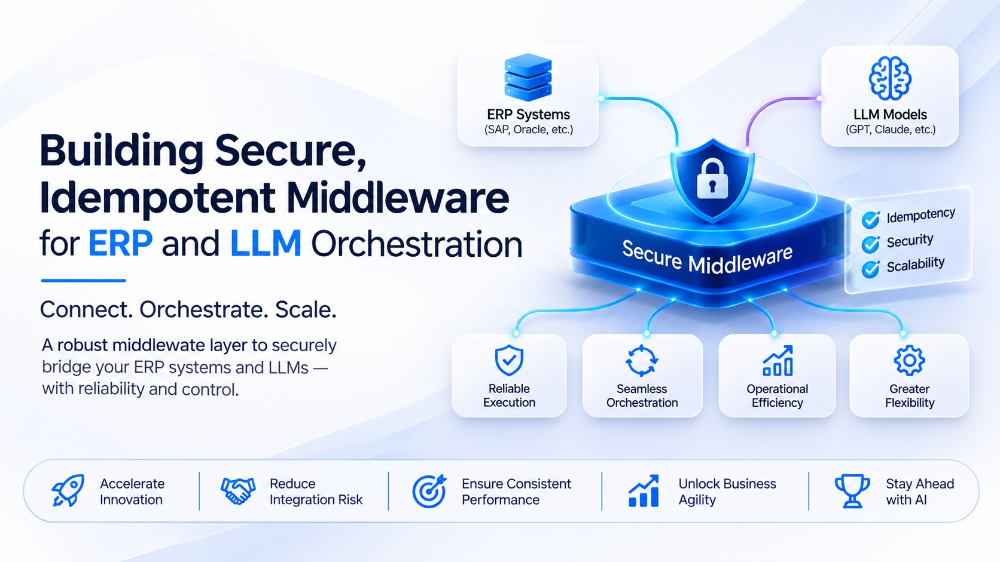

# Building Secure, Idempotent Middleware for ERP and LLM Orchestration



An LLM that can read an ERP is a convenience. An LLM that can write to one is a risk, unless something sits between them. That layer is middleware, and it decides whether a retried request creates one purchase order or three, and whether an agent can see payroll when it only needed inventory.

That is why [production-grade ERP generative AI integration](https://zignuts.com/ai-services/ai-integration/erp-ai-integration-services?utm_source=seo_web2.0&utm_medium=backlink&utm_campaign=seo_referral&utm_id=11) never lets a model call the ERP directly. A controlled layer validates, authorizes, deduplicates, and logs every action first.

## Reference Architecture

```
User / Agent
   |
LLM Orchestrator   (plans steps, proposes tool calls)
   |
Middleware         (auth, validation, idempotency, policy, audit)
   |
ERP Adapter        (maps to the ERP's APIs and business rules)
   |
ERP System
```

## Making Writes Idempotent

Every mutating request carries a unique key, and the middleware remembers what it did with that key.

```http
POST /v1/purchase-orders
Idempotency-Key: po-7f3a91c2-ordered-2026-11-17
Content-Type: application/json

{ "vendor_id": "V-1042", "lines": [{ "sku": "A-77", "qty": 40 }] }
```

1. **Generate the key from intent, not from the attempt.** A retry should produce the same key.
2. **Store the key before acting.** Record it as "in progress" with a unique constraint.
3. **Return the saved result on repeat.** Skip the ERP call if the key already exists.
4. **Handle the in-progress case.** Reject or wait on a second request that arrives mid-run.
5. **Expire keys deliberately.** Keep them long enough to cover realistic retry windows.

## Security Controls

| Control | What it prevents |
|---|---|
| Least-privilege service accounts | An agent reaching data or functions it does not need |
| User identity pass-through | The model acting with more rights than the requester |
| Schema validation on every tool call | Malformed or injected parameters reaching the ERP |
| Allow-list of tools and actions | Unexpected operations proposed by the model |
| Field-level redaction | Sensitive values leaving the ERP in prompts |
| Secrets in a vault | Credentials appearing in prompts, logs, or code |
| Immutable audit log | Actions that cannot be traced to a person and a request |

## Failure Handling Checklist

- [ ] Retries use backoff and the same idempotency key
- [ ] Timeouts are treated as unknown, then reconciled against the ERP
- [ ] Partial multi-step workflows have compensating actions
- [ ] Failed jobs move to a dead-letter queue for review
- [ ] Rate limits protect the ERP from bursts of agent traffic

## Test Plan

| Test | What it checks |
|---|---|
| Replay | The same request sent many times causes one ERP effect |
| Fault injection | Dropped responses and killed processes recover cleanly |
| Permissions | Users cannot reach data outside their access via the agent |
| Sandbox, then shadow | Behavior is proven before limited production |

## Get Started

Ready to connect LLMs to your ERP safely? Visit [zignuts.com](https://zignuts.com/) to speak with the team.
